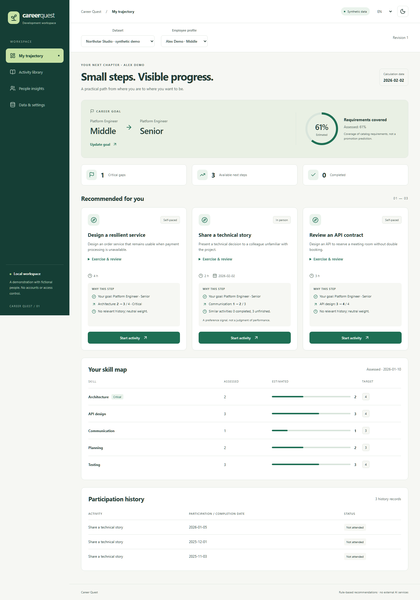

# Career Quest

[](https://github.com/IliasGalikhanov/career-quest/actions/workflows/ci.yml)

A local career development workspace built with **Go, React, and SQLite**.
Choose a career goal, understand your skill gaps, and take a practical next step.
Every recommendation explains its connection to the goal, the expected skill gain,
and the relevant participation history.



## Run from a clean clone

Install Docker Desktop (or Docker Engine with the Compose plugin), then:

```sh
git clone https://github.com/IliasGalikhanov/career-quest.git
cd career-quest
docker compose up --build -d --wait
```

Open **http://localhost:8080** and choose **Explore the demo** / **Открыть демо**.
No API keys, accounts, or external AI services are needed. The first build downloads
dependencies; subsequent application use works offline.

```sh
docker compose logs -f app
docker compose stop
docker compose start
```

SQLite lives in the named `career-data` volume. `docker compose down` also preserves
that volume. **`docker compose down -v` deletes it.** Export a JSON backup from
**Data & settings** before deliberately removing local data. To use another port,
set `CQ_PORT=8090` in a local `.env` file before starting Compose.

## Try the complete workflow

1. Open the demo and select **Alex Demo**, a fictional Platform Engineer.
2. Inspect the Middle → Senior goal and the separate assessed and estimated levels.
3. Read why **Design a resilient service** is recommended: the critical architecture
   gap matters more than the lowest individual skill.
4. Start the activity, then mark it complete. Architecture changes from **2 to 3**;
   estimated coverage changes from **61% to 67%**. The original assessment stays at 2.
5. Refresh the page or restart the container. Progress and participation remain saved.
6. Explore the activity library, change the goal or time limit, and open People insights.

These percentages are calculated on a fictional example. They are **not** measured
learning outcomes, recommendation accuracy, or the probability of a promotion.

## Features

- Career goals, skill requirements, assessed levels, and estimated progress.
- Up to three feasible next steps with structured, auditable explanations.
- Prerequisite, audience, session, duration, repeatability, and completion checks.
- Participation lifecycle with transactional updates and stale-write protection.
- Searchable activity library with explicit reasons for unavailable steps.
- HR summaries of skill gaps and participation, filtered by department and role.
- JSON bundle import/export, four-file JSON/CSV import, and append-only profile imports.
- Read-only import preview, validation paths, and a retained recommendation evidence log.
- Russian, Kazakh, and English; light/dark themes; responsive and keyboard-accessible UI.
- Persistent SQLite storage, versioned SQL migrations, Docker health checks, and CI.

## Local development

Use Go **1.25+** and Node.js **24**. Dependencies are locked in `go.sum` and
`web/package-lock.json`.

```sh
go mod download
npm --prefix web ci
npm --prefix web run build
go run ./cmd/server
```

For frontend hot reload, keep the Go server running and start a second terminal:

```sh
npm --prefix web run dev
```

Vite prints its local URL and proxies `/api` to the Go server on port 8080. Avoid
running the native Go server and Compose on the same port simultaneously.

| Environment variable | Default | Purpose |
| --- | --- | --- |
| `CQ_ADDR` | `127.0.0.1:8080` | Native server listen address |
| `CQ_DATABASE` | `data/career-quest.db` | SQLite database file |
| `CQ_WEB_DIR` | `web/dist` | Built React assets |
| `CQ_PORT` | `8080` | Compose host port only |

## Checks

```sh
go vet ./cmd/... ./internal/...
go test -race -cover ./cmd/... ./internal/...
npm --prefix web run lint
npm --prefix web run build
cd web
npx playwright install chromium
npm run test:e2e
```

The race detector needs a C compiler (available on GitHub's Ubuntu runner). Browser
tests start a separate Go server on port 8081 and use `data/browser-tests.db`.
They do not change the Docker database. On Linux, use
`npx playwright install --with-deps chromium` to install browser system dependencies.

With Compose running, this optional standard-library Python script verifies durable
state after removing and recreating the container, keeping the data volume:

```sh
python scripts/check_persistence.py
```

It adds one fictional test dataset. CI runs the same checks on every push to `main`
and every pull request. See [verification](docs/verification.md) for recorded results.

## Data and scope

The included [example](examples/demo.json) is independently authored synthetic data:
12 fictional employees, 10 skills, 12 activities, and 3 role families. Recreate it with:

```sh
go run ./cmd/demo examples/demo.json
```

The seed is fixed at 73 and the demo calculation date is **2026-02-02**. Advancing the
date is explicit; the application never silently moves old sessions into the future.
No third-party hackathon dataset, real HR records, private analysis, or trained model
is included. This project is not affiliated with a bank or employer.

This is a **single-user local demonstration**, not a deployed HR system. Navigation
between employee and HR views is not authorization. Do not expose it publicly or load
real personal records. A course completion produces a rule-based estimate, not a
verified assessment. Unknown completion dates remain uncertain by default.

The application does not train a model or call an LLM. Its deterministic ranking is
described in [architecture and ranking](docs/architecture.md). Weights are explicit
design choices, not learned estimates of employee success.

- [Data contract and imports](docs/data-format.md)
- [Architecture and limitations](docs/architecture.md)
- [Verification results](docs/verification.md)
- [Dependency notices](THIRD_PARTY_NOTICES.md)

## Кратко по-русски

Запуск: `docker compose up --build -d --wait`, затем http://localhost:8080.
Нажмите «Открыть демо», выберите цель, начните рекомендованную активность и отметьте
её выполненной. «Данные и настройки» позволяют импортировать свои **синтетические**
данные, изменить ограничения и скачать резервную копию. База сохраняется в Docker-томе.
Аккаунтов и публичного развёртывания нет; расчётный рост навыков не является аттестацией.
